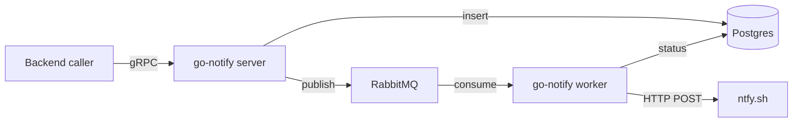

# go-notify

Internal gRPC notification service. Backend systems call it; it stores,
queues, and delivers push notifications through [ntfy](https://ntfy.sh).

## How it works



## Quickstart

1. `make docker-up` (starts Postgres, RabbitMQ, Redis, server, worker, Prometheus, Grafana, Loki).
2. Send a notification:

   ```bash
   grpcurl -plaintext -H 'x-api-key: change-me' \
     -d '{"user_id":"u1","title":"Hi","message":"hello","type":"push"}' \
     localhost:50051 notify.NotificationService/SendNotification
   ```

3. Check its status:

   ```bash
   grpcurl -plaintext -H 'x-api-key: change-me' \
     -d '{"notificationId": 1}' \
     localhost:50051 notify.NotificationService/GetNotificationStatus
   ```

4. `make docker-down`.

## Docs

- [Architecture](docs/architecture.md)
- [API](docs/api.md)
- [Configuration](docs/configuration.md)
- [Operations](docs/operations.md)
- [Development](docs/development.md)

## License

MIT, see [LICENSE](LICENSE).
